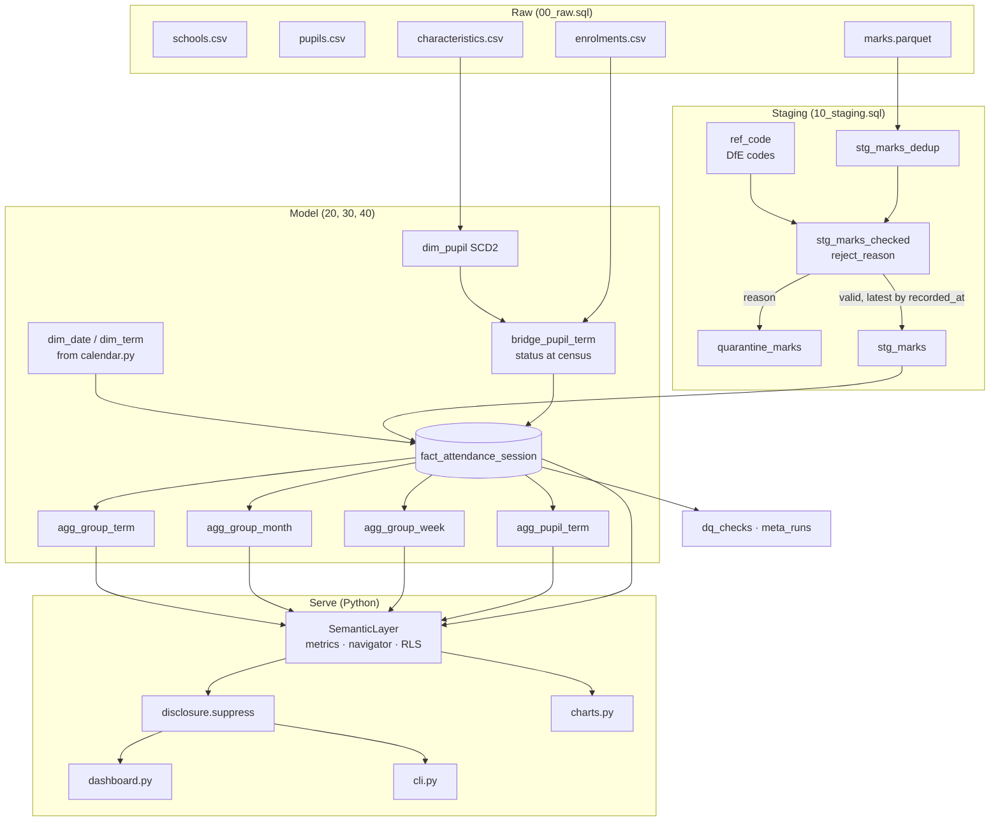

# Architecture

## Key design decisions

### 1. Grain: one row per pupil per session
Attendance is defined on half-day sessions, so the fact table has one row per pupil, day and session (1.78M rows a year for 4,928 pupils). Every measure is a 0/1 flag (`possible`, `present`, `authorised`, `unauthorised`, `missing`, `amended`), which makes all session measures additive. **Rejected:** a daily grain with AM/PM columns. It halves the rows but makes "sessions missed" depend on the column, and partial days (a PM medical appointment) become awkward.

### 2. Characteristics as at census day (SCD2 + bridge)
FSM and SEN status change during the year, and `dim_pupil` keeps every version (SCD Type 2, `valid_from`/`valid_to`). Reporting needs a single rule, though. Using the status on the day of each session would put a pupil into two FSM groups within a term, and a term aggregate would no longer match the pupil-level figures. The mart follows DfE practice: status is taken **as at the termly census date** (or at entry/leaving for pupils not on roll that day), resolved once in `bridge_pupil_term` with a range join on the SCD2 rows. A test checks that every pupil has one status per term.
**Trade-off:** a pupil who becomes FSM-eligible in November counts as FSM only from the spring term. That matches published statistics, but differs from a "live" MIS view.

### 3. Validate before "latest wins"
MIS amendments mean several marks per session. `QUALIFY row_number() OVER (PARTITION BY pupil, date, session ORDER BY recorded_at DESC) = 1` picks the latest, but only among rows that passed validation. If validation ran afterwards, a corrupt row recorded an hour later (code `Z`) would replace the real mark and then be quarantined, losing the session entirely. A test checks that such sessions keep their earlier valid mark.

### 4. Aggregates hold only additive measures
The four aggregates store session counts only, never rates or head counts, so any coarser answer is a plain `SUM` and every table reconciles to the fact (checked in `50_quality.sql` and by a Hypothesis test over random filters). Distinct pupil counts and thresholds (persistent absence is a per-pupil test) are **not** additive. Summing weekly "pupils" would count one child 39 times. These metrics are flagged `needs_pupils` and can only be answered from a pupil-grain table.

### 5. The aggregate navigator
`SemanticLayer.choose()` lists the tables whose dimensions cover the request (grouping, filters and the caller's security scope). It drops those at the wrong grain for the metrics, then picks the one with the fewest rows. It is deliberately simple: a declared capability list per table, not cost-based optimisation. **Measured:** school × term rates take 1.10 ms from `agg_group_term` (1,301 rows) and 5.06 ms from the fact (1.78M rows). DuckDB is fast enough that the gain is modest at one year. The design matters more for multi-year history, many concurrent dashboard users, or a slower warehouse.
**Rejected:** DuckDB materialised views (not supported) and asking analysts to pick tables (the commonest cause of wrong distinct counts).

### 6. Pupil metrics in two steps
Persistent absence for "school by term" is computed as: one row per pupil per slice (summing their sessions), then the share of pupils whose absence is ≥ 10% of possible sessions. Without a term dimension, a pupil's three terms are summed first, which is the DfE's year-level definition. The output names the metric precisely, so users are not tempted to average termly rates.

### 7. Row-level security in the compiler, not the dashboard
The `Principal` scope is merged into the filters inside `compile()`, so every consumer (CLI, dashboard, charts, tests) gets it. An explicit filter outside the scope raises `AccessDenied` rather than silently returning nothing, because a head asking for another school should be told no. The per-school dashboard pages are built by running queries as that head.
**Limitation:** it is application-level RLS. Anyone with the DuckDB file sees everything; a production deployment would add database roles or secure views.

### 8. Disclosure control as a separate, testable step
`suppress()` works on any result frame. It applies primary suppression (1–4 pupils), then repeats secondary suppression across every "sibling" group (rows sharing all dimensions but one) until no group has exactly one hidden cell. The next-smallest row is hidden first; a zero row is used only when nothing else remains. Hypothesis tests the two invariants on random tables: no published cell has 1–4 pupils, and no group exposes a single hidden cell. Hypothesis found the zero-row case during development.
**Trade-off:** this is conservative and can over-suppress small schools. Rounding head counts to 5 (`round_counts`) is available for wider publication.

### 9. SQL in files, orchestration in Python
Transformations live in ordered `.sql` files that can be reviewed like dbt models; Python only loads raw files, registers the calendar, runs the layers, records `meta_runs` and enforces blocking checks. **Rejected:** dbt itself for this project. The semantic layer, navigator and disclosure logic are the point here, and keeping one runtime keeps the build to about 1.6 s.

## Data quality

| Check | Blocking |
|---|---|
| one mark per pupil, day and session | yes |
| possible = present + authorised + unauthorised | yes |
| every staged mark reaches the fact | yes |
| week and pupil-term aggregates reconcile to the fact | yes |
| every pupil has exactly one current SCD2 row | yes |
| registers not taken ≤ 0.5% of sessions | advisory |
| quarantined raw rows ≤ 0.1% | advisory |
| absences still coded N ≤ 5% | advisory |

Latest run: 210 rows quarantined (177 unknown code, 33 marks after a pupil left), 0.195% of sessions with no register taken, 4.0% of absences still without a reason.

## Known limitations and next steps

- One academic year. Next: add `academic_year` to every table and partition aggregates by it, and compare against the same point last year.
- Aggregates are rebuilt in full (about 0.1 s here). Next: incremental refresh by week, with late amendments re-aggregating only the affected weeks.
- Persistent absence uses all possible sessions; DfE publications exclude some pupils (for example those with very few possible sessions). Next: make the inclusion rule a metric parameter.
- No national benchmark is loaded, because real figures would need downloading. Next: a `ref_benchmarks` table from published DfE CSVs.
- The dashboard is static HTML. Next: serve the same semantic layer behind an API with authenticated principals.
