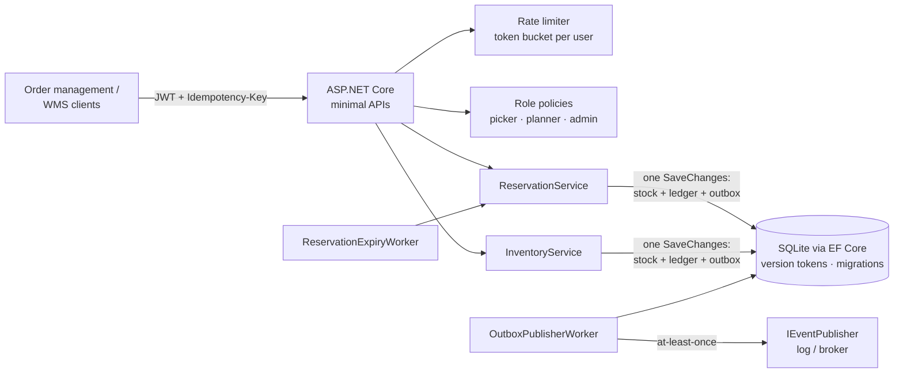

# 📦 Warehouse Stock Reservation API

A stock reservation service for a fictional UK home-and-garden retailer with four distribution
centres (Daventry, Manchester, Bristol, Glasgow). Order management asks it to **hold stock for an
order**. Pickers later **confirm** the pick, or the hold is **released** or **expires** and the units
go back on sale. It is built with ASP.NET Core minimal APIs on .NET 10 and EF Core with SQLite.
The hard part is correctness under concurrency: many orders compete for the same fast-moving SKUs,
so the service uses optimistic concurrency with retries, idempotency keys for safe client retries,
all-or-nothing multi-line holds, an append-only stock ledger and a **transactional outbox** that
publishes integration events at least once. A load test fires 3,000 concurrent reservations at
five hot SKUs and proves that **no unit is ever oversold**.

## 🏛 Architecture



Design decisions, trade-offs and limitations are in [docs/ARCHITECTURE.md](docs/ARCHITECTURE.md).

**Role focus:** Software Engineer · **Stack:** C# 14 / .NET 10, ASP.NET Core minimal APIs, EF Core 10 +
SQLite (migrations, concurrency tokens), JWT bearer auth with role policies, built-in rate limiting,
`BackgroundService` workers, OpenAPI, xUnit + `WebApplicationFactory`, Docker

## 🧩 The problem

When two web orders for the last three kettles arrive in the same millisecond, the warehouse
system must give the stock to one of them and tell the other it is short. It must never promise
four. Clients retry on timeouts, so a retried request must not double-reserve. A hold that is
never picked must not lock stock away for ever. Downstream systems (purchasing, the WMS, customer
notifications) need to hear about every change, even if the message broker is down when it happens.

## ✨ Features

- **All-or-nothing multi-line reservations.** Every line is checked before any stock is touched, so a partial hold never exists.
- **Optimistic concurrency.** `StockItem.Version` and `Reservation.Version` are EF Core concurrency tokens. A lost update raises `DbUpdateConcurrencyException`, and the whole unit of work is retried against fresh data with jittered backoff.
- **Idempotency keys.** A required `Idempotency-Key` header plus a SHA-256 fingerprint of the request body. A retry with the same body replays the original (`200`, `Idempotent-Replayed: true`). Reusing the key with a different body returns `409`. A unique index settles races between concurrent duplicates.
- **State machine.** Pending → Confirmed | Released | Expired, with domain guards (you cannot confirm an expired hold, and you cannot release a reservation twice).
- **Hold expiry.** A `BackgroundService` sweeps overdue holds and returns the stock. Expiry and confirm race safely through the version tokens.
- **Transactional outbox.** Events (`reservation.*`, `stock.low`, `stock.received`) are written in the same transaction as the state change. A worker publishes them in order with exponential backoff and dead-letters a message after N failed attempts.
- **Append-only stock ledger** with a reconciliation endpoint that replays movements and compares the result with balances.
- **Security.** JWT bearer tokens (HMAC-SHA256), PBKDF2 password hashes compared in constant time, and four role-based policies.
- **Rate limiting.** A token bucket per user on writes and a fixed window per IP on the token endpoint. Rejected requests get `429` with a `Retry-After` header.
- **API behaviour.** RFC 9457 problem responses with stable error codes, pagination and filtering (warehouse, SKU prefix with escaped `LIKE`, below reorder point), stock valuation in £ aggregated in SQL, OpenAPI document, health check.
- **Operations.** Options validated on start, structured JSON logs through source-generated `LoggerMessage`, a Dockerfile and a Makefile.

## 🚀 Quick start

```bash
cd warehouse-stock-reservation-api
dotnet test -c Release                                   # 65 tests
dotnet run --project src/StockReservation.Api --urls http://localhost:5080
./scripts/demo.sh                                        # in a second terminal (needs curl + jq)
dotnet run -c Release --project src/StockReservation.LoadTest -- 3000 32 600
```

On first start the API applies EF Core migrations and seeds 1,000 stock lines (250 SKUs × 4 sites).
The OpenAPI document is served at `/openapi/v1.json`. Demo users, with credentials for local use only, are
`planner.daventry / planner-demo-pass`, `picker.manchester / picker-demo-pass` and
`ops.admin / admin-demo-pass`. Override the signing key with `Jwt__SigningKey` in any real deployment.

| Endpoint | Role | Purpose |
|---|---|---|
| `POST /auth/token` | anonymous | exchange credentials for a JWT |
| `GET /api/stock` · `/{wh}/{sku}` · `/movements` · `/valuation` | any | search, detail, ledger, £ valuation |
| `POST /api/stock/{wh}/{sku}/receipts` | planner | goods-in |
| `POST /api/stock/{wh}/{sku}/adjustments` | admin | stock-count correction |
| `POST /api/reservations` (+ `Idempotency-Key`) | planner | hold stock for an order |
| `POST /api/reservations/{id}/confirm` | picker | pick: units leave stock |
| `POST /api/reservations/{id}/release` | planner | cancel and return stock |
| `GET/POST /api/ops/outbox`, `/expire`, `/reconcile` | admin | operational controls |

## 📟 Example output

Real output of `scripts/demo.sh` against a freshly seeded API:

```text
== Stock below reorder point at Daventry (first 3)
{"totalCount":23,"items":[{"sku":"DIY-00009","onHand":12,"reserved":0,"available":12,"reorderPoint":15},{"sku":"DIY-00033","onHand":28,"reserved":0,"available":28,"reorderPoint":39},{"sku":"ELC-00005","onHand":10,"reserved":0,"available":10,"reorderPoint":33}]}
== Reserve 2 lines for order ORD-10001 (Idempotency-Key: demo-ord-10001)
HTTP/1.1 201 Created
Location: /api/reservations/2d0a0934-62e4-49de-a3eb-38de0e900b62
Idempotent-Replayed: false
== Same request again (network retry)
HTTP/1.1 200 OK
Idempotent-Replayed: true
== Same key, different body
{"status":409,"code":"idempotency.key_reused","detail":"This Idempotency-Key was already used with a different request body."}
== Ask for more than is available
{"status":409,"code":"stock.insufficient","detail":"Insufficient stock: KIT-00007 (requested 9000, available 156)."}
== Picker tries to create a reservation (wrong role)
403
== Picker confirms the pick
{"status":"Confirmed","totalUnits":7,"lines":[{"sku":"KIT-00007","quantity":5},{"sku":"GDN-00002","quantity":2}]}
== Ledger for KIT-00007
{"type":"Allocate","quantity":-5,"onHandAfter":156,"reservedAfter":0,"actor":"picker.manchester"}
{"type":"Reserve","quantity":5,"onHandAfter":161,"reservedAfter":5,"actor":"planner.daventry"}
== Outbox after the background publisher ran
{"pending":0,"published":2,"deadLettered":0,"oldestPendingAt":null}
== Valuation (GBP)
{"warehouseCode":"BRS1","skuCount":250,"unitsOnHand":92940,"unitsReserved":0,"stockValueGbp":4419915.24,"reservedValueGbp":0,"skusBelowReorder":25}
{"warehouseCode":"DIR1","skuCount":250,"unitsOnHand":104775,"unitsReserved":0,"stockValueGbp":4649552.31,"reservedValueGbp":0,"skusBelowReorder":23}
{"warehouseCode":"GLA1","skuCount":250,"unitsOnHand":86751,"unitsReserved":0,"stockValueGbp":4179113.66,"reservedValueGbp":0,"skusBelowReorder":11}
{"warehouseCode":"MAN1","skuCount":250,"unitsOnHand":122789,"unitsReserved":0,"stockValueGbp":5218766.25,"reservedValueGbp":0,"skusBelowReorder":16}
== Ledger reconciliation
{"consistent":true,"mismatches":[]}
```

### Concurrency benchmark

`dotnet run -c Release --project src/StockReservation.LoadTest -- 3000 32 600` runs in-process against a
real SQLite file in WAL mode on an Apple-silicon Mac. It sends 3,000 reservation requests, 32 at a time,
for five hot SKUs that each have only 600 units:

```text
Concurrent reservation load test: 3000 requests, parallelism 32, 5 hot SKUs x 600 units
  succeeded                1503
  insufficient stock       1497
  gave up (conflicts)         0
  optimistic retries         17  (0.01 per success)
  throughput               1263 req/s  (2.38s)
  latency p50/p95/p99  0.9 / 2.1 / 5.4 ms

  SKU         on-hand  reserved  expected  oversold?
  ELC-00004       600       600       600  no
  KIT-00001       600       600       600  no
  KIT-00002       600       600       600  no
  PET-00005       600       600       600  no
  TOY-00003       600       600       600  no

  idempotent replays returning the original reservation: 200/200
  ledger reconciliation mismatches: 0
RESULT: PASS (no oversell, ledger consistent)
```

Each SKU sells out to exactly 600 units. The other 1,497 requests get a clean `stock.insufficient`
and none gives up on contention. Running the same harness with enough stock for every request
(`3000 32 1500`) measured about 800 req/s with 67 optimistic retries.

## 🏗 Project structure

```
warehouse-stock-reservation-api/
├── StockReservation.slnx · Directory.Build.props · global.json · .editorconfig
├── src/
│   ├── StockReservation.Domain/          # StockItem, Reservation state machine, ledger, outbox, Result/DomainError
│   ├── StockReservation.Application/
│   │   ├── Persistence/                  # DbContext, Unix-ms DateTimeOffset converter, EF migrations
│   │   ├── Reservations/                 # ReservationService, validation, request fingerprinting
│   │   ├── Inventory/                    # goods-in, adjustments, search, valuation, reconciliation
│   │   ├── Outbox/                       # OutboxWriter, dispatcher, publishers, background workers
│   │   ├── Common/                       # options, paging, optimistic-concurrency retry
│   │   └── Seeding/                      # deterministic UK network seed
│   ├── StockReservation.Api/             # Program, JWT auth, policies, rate limiting, endpoints
│   └── StockReservation.LoadTest/        # concurrent oversell benchmark
├── tests/StockReservation.Tests/         # domain, service, outbox, concurrency, API integration tests
├── scripts/demo.sh · Dockerfile · Makefile
└── docs/ARCHITECTURE.md
```

## 🎯 Skills demonstrated

- **Concurrency control in a real database:** optimistic version tokens, retry with jitter, and a race-free idempotency check backed by a unique index. A parallel test proves there is no oversell.
- **Distributed-systems patterns:** transactional outbox, at-least-once delivery, backoff and dead-lettering, idempotent consumers. The README and ARCHITECTURE doc explain the delivery guarantee honestly.
- **Clean layering:** a pure domain model with invariants and a `Result` type, application services, and a thin HTTP layer. No business logic sits in endpoints.
- **API security:** JWT, role policies, PBKDF2 hashing, rate limiting, problem details with machine-readable codes.
- **Production .NET:** options validation, `TimeProvider` for testable time, `BackgroundService`, `PeriodicTimer`, source-generated logging, EF Core migrations, and analyzers with warnings treated as errors.
- **Testing:** 65 xUnit tests covering domain rules, a model-based invariant test over 10,000 random operations, service tests on real SQLite, outbox retry timing, parallel writers, and `WebApplicationFactory` tests for authentication, authorisation, idempotency, expiry and rate limits.

## 🧪 Running tests

```bash
dotnet restore
dotnet format --verify-no-changes --no-restore
dotnet build --no-restore -c Release -warnaserror
dotnet test --no-build -c Release
```

## 📄 License

MIT. See [LICENSE](LICENSE).
