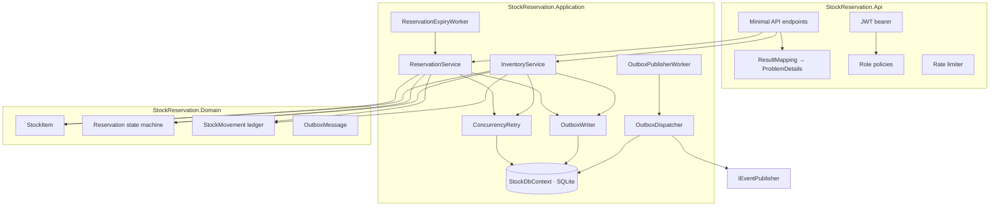
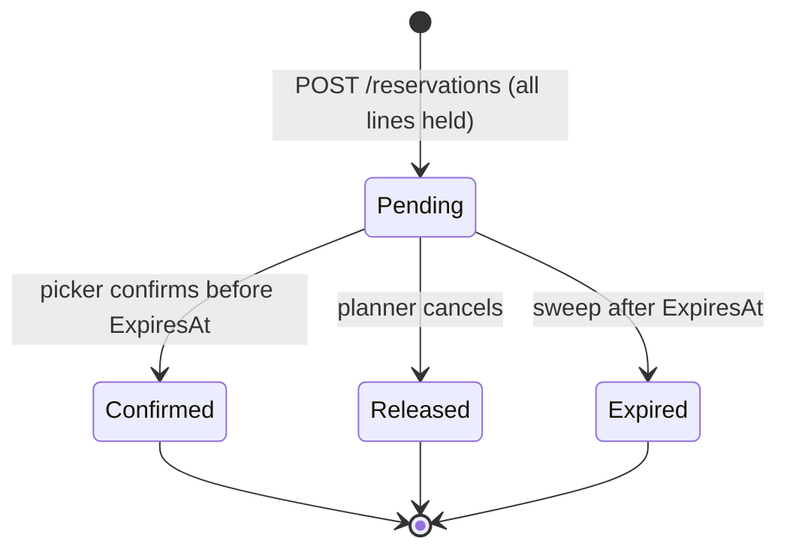

# Architecture: Warehouse Stock Reservation API

## Context

Order management (OMS) calls this service to hold stock for an order. Warehouse pickers confirm
the pick, and planners cancel holds or book goods-in. Downstream systems (purchasing, the WMS,
customer notifications) consume integration events. The service owns one invariant above all
others: **for every stock line, `0 ≤ Reserved ≤ OnHand`, under any amount of concurrency.**

### Reservation lifecycle

| Transition | Stock effect | Ledger | Event |
|---|---|---|---|
| create | `Reserved += q` per line | `Reserve +q` | `reservation.created` (+ `stock.low` if a line crosses its reorder point) |
| confirm | `Reserved -= q`, `OnHand -= q` | `Allocate −q` | `reservation.confirmed` |
| release | `Reserved -= q` | `Release −q` | `reservation.released` |
| expire | `Reserved -= q` | `Expire −q` | `reservation.expired` |

## Key design decisions

### 1. Optimistic concurrency, retried as a whole unit of work
`StockItem.Version` and `Reservation.Version` are concurrency tokens. Every domain mutation bumps
the version, so EF Core issues `UPDATE … WHERE Id = @id AND Version = @old`. If a concurrent writer
got there first, zero rows match and `DbUpdateConcurrencyException` is raised.
`ConcurrencyRetry` clears the change tracker and re-runs the whole read-decide-write function,
waiting a fully jittered delay of up to 64 ms between attempts.

- **Chosen over pessimistic locking (`SELECT … FOR UPDATE`)**: SQLite has no row locks, and
  optimistic control keeps read paths lock-free. Contention is limited to a few hot SKUs, where
  retries are cheap. The load test measured 17 retries across 1,503 successful reservations.
- **Chosen over atomic SQL (`UPDATE … SET Reserved = Reserved + q WHERE OnHand - Reserved >= q`)**:
  that is faster for a single line, but multi-line all-or-nothing holds, ledger rows and outbox
  events would need hand-written SQL per operation. Keeping the rules in the domain model and
  letting the database detect conflicts keeps one source of truth.
- The `CHECK (Reserved >= 0 AND Reserved <= OnHand)` constraint is a second line of defence. A
  bug in the domain code would fail the transaction rather than corrupt stock.

### 2. Idempotency key + request fingerprint
Clients must send `Idempotency-Key`. The service stores the key and a SHA-256 hash of a canonical
form of the request: SKUs upper-cased, lines sorted, so `[A,B]` and `[b,a]` hash the same.

- Same key and same body: the original reservation is returned (`200`, `Idempotent-Replayed: true`).
- Same key and different body: `409 idempotency.key_reused`. Silently returning the old result
  would hide a client bug.
- Two identical requests in flight together: both pass the pre-check, and the unique index on
  `IdempotencyKey` rejects the second insert. That request catches the violation and replays the
  winner, so neither request reserves stock twice.
- Rejected alternative: a separate idempotency-response cache table storing serialised HTTP
  responses. It is more general but duplicates state. Here the reservation itself is the record.

### 3. Transactional outbox, at-least-once delivery
Events are added to `outbox_messages` in the same `SaveChanges` as the state change, so an event
exists if and only if the change committed. This avoids the dual-write problem of publishing to a
broker after commit. `OutboxPublisherWorker` polls every 2 s and publishes in `OccurredAt` order.
A failure schedules a retry at `base × 2^(attempt-1)`, and after `OutboxMaxAttempts` the message
is dead-lettered and logged at Error.

- The batch is saved after publishing. A crash in between republishes the batch, so delivery is
  **at least once** and consumers must de-duplicate on the message id. Exactly-once delivery would
  need the broker to take part in the transaction, and it is not worth that here.
- Ordering is per batch and best-effort: a failing message does not block later ones. Messages of
  different types can therefore be reordered during an outage. Consumers that need strict order per
  reservation should use the event's `occurredAt`.
- Only one dispatcher should run per database. A multi-instance deployment would claim batches
  with a lease column, or with `FOR UPDATE SKIP LOCKED` on PostgreSQL.

### 4. Time as a dependency
All services take `TimeProvider`. Tests use a `TestClock` to move through hold expiry and outbox
backoff deterministically, with no `Thread.Sleep`. JWTs are the exception: they are always stamped
with wall-clock time, because the bearer handler validates them against wall-clock time.

### 5. Storing `DateTimeOffset` as Unix milliseconds
SQLite has no date type, and EF Core cannot translate comparisons or `ORDER BY` on `DateTimeOffset`
stored as text. A global value converter stores UTC Unix milliseconds, so expiry sweeps
(`ExpiresAt <= now`) and outbox polling run as indexed SQL range scans, not client-side filters.

### 6. Ledger + reconciliation
Every stock mutation writes a `StockMovement` with signed quantity and the balances after the
move. `/api/ops/reconcile` replays the reserve, release, expire and allocate movements and
compares the result with `Reserved` for every stock line. The load test and an API test assert
zero mismatches.

## Indexes

| Table | Index | Serves |
|---|---|---|
| `stock_items` | unique `(WarehouseCode, Sku)` | lookups, prefix search, the integrity rule of one line per site |
| `reservations` | unique `IdempotencyKey` | replay and race resolution |
| `reservations` | `(Status, ExpiresAt)` | the expiry sweep |
| `outbox_messages` | `(Status, NextAttemptAt)` | dispatcher polling |
| `stock_movements` | `(StockItemId, OccurredAt)` | ledger pages per SKU |

## Security

- Short-lived HMAC-SHA256 JWTs with issuer and audience validation and 30 s clock skew.
- Demo passwords are stored as PBKDF2-SHA256 hashes with 100k iterations and compared in constant
  time. A dummy hash runs when the username is unknown, so response timing does not reveal valid
  usernames.
- Four policies: read (any role), pick (picker or admin), plan (planner or admin), admin. Tests
  check the `401` and `403` paths.
- Writes are rate-limited by a token bucket per user. `/auth/token` has a fixed window per IP to
  slow credential stuffing.
- The signing key in `appsettings.json` is a placeholder for development only. Supply
  `Jwt__SigningKey` from a secret store in any real deployment.

## Known limitations and next steps

- **SQLite serialises writers.** That makes it a sound correctness baseline, but throughput is
  capped at about 1.2k reservations/s on one file. The next step is PostgreSQL with the same EF
  model (`xmin` as the concurrency token) and partitioning the hot SKUs.
- **No authentication server.** Demo users live in configuration. A production deployment would
  trust an OIDC provider (Entra ID, Auth0) and drop `/auth/token`.
- **The outbox dispatcher is a single instance.** It needs a lease or `SKIP LOCKED` before scaling
  out.
- **Backorders and substitutions are not handled.** A short reservation is rejected outright. A
  real OMS might want partial holds with a backorder line, which would be an explicit opt-in flag.
- **No stock transfers between warehouses yet.** This is a natural extension: a two-legged movement
  in one transaction.
